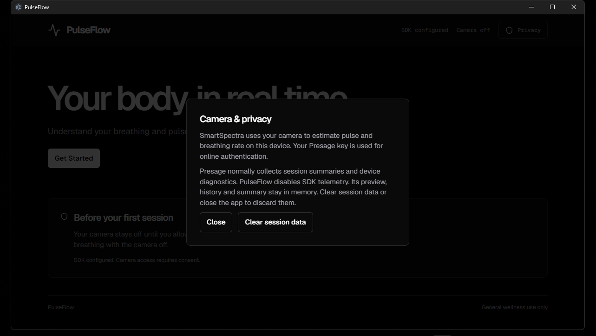
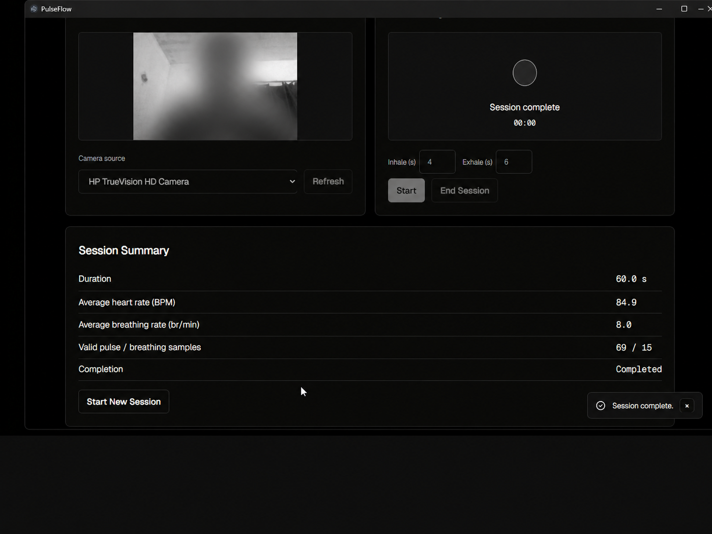

# PulseFlow

### Your body, in real time.

**A privacy-conscious desktop experience for real-time contactless physiological sensing and guided breathing, powered by the Presage SmartSpectra SDK.**

Built for the **Presage SmartSpectra SDK Challenge 2026**.

[](https://www.electronjs.org/)
[](https://www.typescriptlang.org/)
[](https://presagetech.com/)
[](#getting-started)
[](https://dev.to/challenges)

---


<p align="center">
  <strong>Contactless sensing. Real measurements. Thoughtful interaction.</strong>
</p>

<p align="center">
  <a href="https://youtu.be/8ztd4aoxduk"><strong>Watch Demo</strong></a>
  &nbsp;&nbsp;|&nbsp;&nbsp;
  <a href="https://github.com/Ezequie1Sc/PulseFlow"><strong>Source Code</strong></a>
  &nbsp;&nbsp;|&nbsp;&nbsp;
  <a href="https://smartspectra.presagetech.com/docs/nodejs/"><strong>SmartSpectra Documentation</strong></a>
</p>

## Overview

**PulseFlow** is a desktop application that transforms a standard webcam into an interactive human-sensing experience.

Powered by the **Presage SmartSpectra SDK**, it estimates physiological signals such as heart rate and breathing rate without requiring wearable devices or specialized external sensors.

PulseFlow brings these measurements into a minimal, interactive interface where users can observe live physiological data, follow guided breathing exercises, and review session summaries.

The project explores a simple idea:

> What if understanding your body's signals could begin with something as familiar as your webcam?

PulseFlow combines contactless sensing with thoughtful user interaction, clear feedback, and explicit consent.

The application is intended for general wellness exploration and technical demonstration, not medical diagnosis or treatment.

---

## Watch the Demo

The demonstration showcases PulseFlow running on Windows with a real webcam and the Presage SmartSpectra SDK.

It highlights live physiological measurements, guided breathing, and the completed session summary.

[](https://youtu.be/8ztd4aoxduk)

**[Watch the full PulseFlow demonstration on YouTube](https://youtu.be/8ztd4aoxduk)**

### What the demonstration covers

1. PulseFlow desktop interface.
2. Camera-based monitoring.
3. Live heart rate estimation.
4. Live breathing rate estimation.
5. Real-time physiological charts.
6. Guided breathing interaction.
7. Session completion and summary.

The demonstration uses real SmartSpectra measurements. The camera imagery can be anonymized for presentation without substituting the physiological data.

---

## The Experience

### 01 — A Minimal Human-Sensing Interface

PulseFlow follows a clean, monochromatic design direction inspired by modern developer tools and the Geist design language.

The interface emphasizes clarity and readability, allowing the physiological information to remain the focus.


### 02 — Live Physiological Monitoring

PulseFlow visualizes physiological measurements generated through SmartSpectra.

The dashboard presents current values and time-based charts for accepted measurements.


**Available metrics**

- Heart rate, measured in beats per minute (BPM).
- Breathing rate, measured in breaths per minute (br/min).
- Time-series charts of valid measurements.
- Camera and processing status.
- Signal-quality feedback.

PulseFlow does not populate its dashboard with simulated physiological readings.

When valid measurements are unavailable, the interface displays an appropriate waiting state.

### 03 — Camera Consent

The application introduces camera-based monitoring through an explicit consent workflow.

Users are informed about the purpose of camera access before monitoring begins.


### 04 — Privacy and Transparency

Responsible handling of camera-based sensing is a central part of the experience.

PulseFlow provides information about camera use and allows users to control monitoring.



### 05 — Guided Breathing

PulseFlow includes a guided breathing experience with a minimal animated indicator.

Users can configure the inhalation and exhalation durations and control the session through start, pause, resume, and end actions.

The animation is driven by the exercise timer independently of the physiological readings.

This distinction ensures that guided movement is not presented as a measured physiological signal.

### 06 — Session Summary

After completing a guided breathing session, PulseFlow provides an overview of the activity and available physiological measurements.



The summary includes:

- Total session duration.
- Average observed heart rate.
- Average observed breathing rate.
- Number of valid heart rate samples.
- Number of valid breathing rate samples.
- Session completion status.

Averages are calculated from accepted SmartSpectra measurements rather than fabricated values.

---

## Key Features

| Feature | Description |
|---|---|
| Contactless physiological sensing | Uses a standard webcam with the SmartSpectra SDK |
| Live heart rate | Displays valid heart rate estimates in BPM |
| Live breathing rate | Displays valid breathing rate estimates in br/min |
| Real-time charts | Visualizes accepted measurements over time |
| Camera selection | Supports choosing an available camera |
| Signal validation | Handles unavailable, unstable, or invalid readings |
| Guided breathing | Configurable inhalation and exhalation phases |
| Session controls | Start, pause, resume, and end |
| Session summaries | Displays duration, averages, and sample counts |
| Camera consent | Explicit authorization before monitoring |
| Toast notifications | Contextual feedback for application events |
| Error handling | Descriptive SDK, camera, and connectivity states |
| Desktop security | Isolated Electron renderer and restricted IPC communication |

---

## How SmartSpectra Powers PulseFlow

SmartSpectra is the core sensing technology behind the application.

The Node.js SDK processes camera input and provides physiological estimates and signal-validation information.

PulseFlow receives and processes these events before updating its dashboard.

### Processing Pipeline

```text
+-----------------------------+
|        Standard Webcam      |
+--------------+--------------+
               |
               v
+-----------------------------+
|   Presage SmartSpectra SDK  |
|                             |
|   Camera Processing         |
|   Signal Validation         |
|   Physiological Estimation  |
+--------------+--------------+
               |
               v
+-----------------------------+
|       Capture Service       |
|        src/capture.ts       |
+--------------+--------------+
               |
               v
+-----------------------------+
|      Measurement Layer      |
|     src/measurements.ts     |
|                             |
|  Decode / Validate / Filter |
+--------------+--------------+
               |
               v
+-----------------------------+
|        Electron IPC         |
+--------------+--------------+
               |
               v
+-----------------------------+
|        PulseFlow UI         |
|                             |
|  Live Metrics               |
|  Physiological Charts       |
|  Guided Breathing           |
|  Session Summary            |
+-----------------------------+
```

### Requested Metrics

The application requests two SmartSpectra measurements:

```typescript
requestedMetrics: [
  MetricType.PULSE_RATE,
  MetricType.BREATHING_RATE,
]
```

### SDK Events

The implementation handles SmartSpectra events including:

- `processingStatus` — reports processing lifecycle states.
- `validationStatus` — provides signal-quality feedback.
- `metrics` — delivers physiological measurement messages.
- `videoOutput` — supplies camera frames for preview.
- `error` — reports SDK-related failures.

Measurement messages are decoded using the SDK's Protocol Buffers support.

### Data Integrity

PulseFlow is designed to display only accepted physiological measurements.

Its processing layer validates incoming samples and rejects values that do not meet the application's requirements.

If SmartSpectra cannot provide a valid reading, PulseFlow displays:

```text
Heart Rate      —
Breathing Rate  —
Status          Waiting for signal
```

The application does not generate artificial BPM values, breathing rates, or session averages.

---

## Guided Breathing Experience

PulseFlow complements live physiological sensing with a simple guided breathing session.

The default session lasts 60 seconds and uses configurable inhalation and exhalation intervals.

### Session Controls

- **Start:** begins the breathing exercise.
- **Pause:** suspends session progression.
- **Resume:** continues from the paused state.
- **End Session:** finishes the current exercise.
- **Start New Session:** resets the experience for another session.

### Animation Synchronization

The breathing indicator expands and contracts according to the configured phase durations.

The timer and animation share the same session state.

When paused, the phase progression is suspended. When resumed, it continues from the previous state.

The animation is a guidance mechanism, not a physiological measurement.

### Session Statistics

During an active exercise, PulseFlow accumulates accepted physiological measurements.

At completion, the application calculates available averages and valid sample counts for the session.

Missing measurements are not replaced by simulated values.

---

## Design Philosophy

PulseFlow uses a minimal interface influenced by the visual clarity of Vercel and the Geist design language.

The design focuses on making a potentially technical sensing experience approachable.

### Visual Principles

- Monochromatic dark interface.
- Geist Sans and Geist Mono typography.
- Strong information hierarchy.
- Large numerical measurements.
- Subtle borders and neutral surfaces.
- Restrained animations.
- Clear interactive controls.
- Contextual notifications.
- Accessible interface states.

The application avoids unnecessary visual distractions, allowing the user to focus on the live data and breathing experience.

---

## Technology Stack

| Technology | Purpose |
|---|---|
| Electron | Windows desktop application runtime |
| Node.js | Native SDK integration and application services |
| TypeScript | Typed application logic |
| Presage SmartSpectra SDK 3.5.0 | Contactless physiological sensing |
| Protocol Buffers | Physiological measurement decoding |
| HTML5 | User interface structure |
| CSS | Layout, typography, and animations |
| Canvas API | Camera preview and data visualization |
| Geist | Interface typography |
| Lucide | Monochromatic iconography |
| esbuild | Application bundling |
| Node.js Test Runner | Automated tests |

PulseFlow does not require a separate backend server or application database.

---

## Project Architecture

The project separates hardware access, SDK processing, application state, and visual presentation.

```text
PulseFlow/
|
|-- assets/
|   |-- hero.png
|   |-- aplicacion funcionando.png
|   |-- liveoverview.png
|   |-- cameraprivacyallow.png
|   |-- privacy.png
|   `-- resultados.png
|
|-- src/
|   |-- main.ts
|   |-- preload.ts
|   |-- capture.ts
|   |-- camera.ts
|   |-- measurements.ts
|   |-- model.ts
|   `-- errors.ts
|
|-- ui/
|   |-- index.html
|   |-- app.ts
|   |-- chart.ts
|   |-- session.ts
|   |-- toasts.ts
|   `-- style.css
|
|-- tests/
|   |-- core.test.mjs
|   |-- desktop.test.mjs
|   `-- renderer.test.mjs
|
|-- build.mjs
|-- tsconfig.json
|-- package.json
|-- package-lock.json
|-- .env.example
|-- .gitignore
`-- README.md
```

### Main Components

**Electron Main Process — `src/main.ts`**

Creates the desktop window, manages IPC handlers, loads the application configuration, and coordinates native capture operations.

**Preload — `src/preload.ts`**

Exposes a narrow application interface to the renderer while maintaining process isolation.

**Capture Service — `src/capture.ts`**

Manages SmartSpectra initialization, camera selection, processing events, measurement reception, and SDK lifecycle.

**Camera Service — `src/camera.ts`**

Discovers available cameras and converts SDK camera frames into renderer-compatible preview data.

**Measurement Processing — `src/measurements.ts`**

Filters and validates physiological measurements before they are presented.

**Renderer — `ui/app.ts`**

Coordinates user interactions, live measurements, monitoring states, and dashboard updates.

**Breathing Session — `ui/session.ts`**

Manages phase timing, session progression, and pause/resume behavior.

**Toast System — `ui/toasts.ts`**

Provides contextual, reusable notification handling.

---

## Getting Started

### System Requirements

- Windows 11 x64.
- Node.js 24 or newer, compatible with the installed SDK.
- npm.
- A supported webcam.
- A valid Presage SmartSpectra API key.
- Network access for SmartSpectra services when required.

### 1. Clone the Repository

```bash
git clone https://github.com/Ezequie1Sc/PulseFlow.git
cd PulseFlow
```

### 2. Install Dependencies

```bash
npm ci
```

The installation uses the dependency versions recorded in `package-lock.json`.

### 3. Configure Your API Key

Create a local `.env` file using `.env.example`.

On Windows PowerShell:

```powershell
Copy-Item .env.example .env
```

Open `.env` and configure the SmartSpectra key:

```dotenv
SMARTSPECTRA_API_KEY=your_presage_api_key
```

**Never commit your actual API key to a public repository.**

The `.env` file is excluded through `.gitignore`.

### 4. Launch PulseFlow

```bash
npm run dev
```

This command validates and builds the application before launching Electron.

### 5. Begin Monitoring

1. Open PulseFlow.
2. Review the privacy and camera consent information.
3. Select an available webcam.
4. Start monitoring.
5. Position your face and upper chest within the camera frame.
6. Maintain appropriate lighting and minimize movement.
7. Wait for SmartSpectra to produce valid measurements.
8. Observe heart rate and breathing rate values in the dashboard.
9. Start a guided breathing session if desired.
10. Review the session summary.

---

## Development Commands

| Command | Description |
|---|---|
| `npm ci` | Install project dependencies |
| `npm run build` | Type-check and bundle the application |
| `npm run dev` | Build and launch the Electron application |
| `npm start` | Launch the existing Electron build |
| `npm test` | Run automated tests |

### Build

```bash
npm run build
```

### Run Automated Tests

```bash
npm test
```

The test suite includes coverage of:

- Session timing and phase progression.
- Pause and resume behavior.
- Session configuration.
- Session summary calculations.
- Protocol Buffers measurement decoding.
- Measurement validation and filtering.
- Notification deduplication.
- SDK error messaging.
- Electron security expectations.
- Consent and session controls.

**Testing note:** The project has previously completed 7 of 8 automated tests successfully. The desktop security test reported a Windows-specific `Window unavailable` failure in the original test harness. Re-run the suite and verify the current result before considering all tests passed.

Real-camera operation must be verified separately from automated tests.

---

## Consent and Data Handling

PulseFlow is designed around explicit user participation and transparent camera-based sensing.

### Camera Consent

Monitoring requires the user's explicit consent.

The application provides a consent workflow before beginning camera-based capture.

The user can stop monitoring and terminate a session.

### Camera Input

PulseFlow uses a standard webcam through the SmartSpectra SDK.

The application can display a local camera preview while processing physiological signals.

Demo screenshots may obscure the participant's appearance to protect their identity while retaining visible physiological measurements.

### Physiological Measurements

SmartSpectra produces physiological estimates from camera input.

PulseFlow uses accepted measurements to update live charts and calculate session summaries.

### Storage and Retention

PulseFlow does not implement a dedicated persistent physiological-history database or require user accounts.

The application is designed to use measurement information for live interactions and temporary session summaries.

Users should review the current implementation and the SDK documentation for details about native caches, operational logs, and any provider-side retention.

### Data Sharing and Network Communication

PulseFlow uses the Presage SmartSpectra SDK and may require network connectivity for SDK services.

The application configures:

```typescript
enableTelemetry: false
```

This disables the configurable SDK telemetry option used by PulseFlow.

It should not be interpreted as proof that all SDK authentication, operational communication, or provider-side processing is disabled.

Refer to Presage's official documentation for authoritative information about its network behavior, telemetry, and data handling.

### Optional AI Services

PulseFlow does not require an external generative AI service to calculate physiological measurements or execute guided breathing sessions.

### Deletion and Session Control

The application includes user controls for stopping monitoring and managing session state.

Temporary session measurements are intended for the active application experience rather than persistent storage.

### Responsible Use

PulseFlow is not intended for:

- Medical diagnosis.
- Disease detection.
- Treatment recommendations.
- Clinical decision-making.
- Emergency monitoring.
- Non-consensual monitoring.
- Covert surveillance.

**PulseFlow is a non-medical, experimental wellness and human-sensing application.**

---

## Troubleshooting

### Camera Not Detected

- Verify Windows desktop camera permissions.
- Close other applications using the camera.
- Check the webcam connection.
- Refresh the available camera list.

### Waiting for Signal

A visible camera image does not automatically mean physiological measurements are available.

To improve signal acquisition:

- Use even, frontal lighting.
- Keep the face visible.
- Include the upper chest in the frame.
- Reduce body and head movement.
- Allow time for stable signals.
- Check camera frame rate and resolution.

### Insufficient Frame Rate

SmartSpectra can report that the effective camera frame rate is insufficient.

Try a supported camera configuration with at least 25 FPS, preferably 30 FPS.

Lowering capture resolution may help on some devices.

### Presage Connectivity Error

If the SDK reports a connection problem:

- Verify internet connectivity.
- Confirm the API key is configured.
- Check whether Presage services are reachable.
- Restart monitoring after resolving the connection issue.

### No Measurements Available

PulseFlow rejects unavailable or invalid measurements.

It does not replace missing data with artificial values.

---

## Presage SmartSpectra SDK Challenge 2026

PulseFlow was developed as an entry for the **Presage SmartSpectra SDK Challenge 2026**, hosted on DEV Community.

### Challenge Focus

Build an interactive experience that responds meaningfully to real-time human signals captured through a camera.

### Submission Categories

**Best Overall Human-Sensing Experience**

PulseFlow demonstrates the use of real-time physiological sensing through a simple desktop experience.

**Best Thoughtful Real-World Use**

PulseFlow explores a consent-based wellness interaction that combines physiological visualization, guided breathing, and session feedback.

### Submission Resources

| Resource | Link |
|---|---|
| Source Code | [GitHub Repository](https://github.com/Ezequie1Sc/PulseFlow) |
| Video Demonstration | [Watch on YouTube](https://youtu.be/8ztd4aoxduk) |
| SmartSpectra SDK | [Official Documentation](https://smartspectra.presagetech.com/docs/nodejs/) |
| SmartSpectra Repository | [Official GitHub](https://github.com/Presage-Security/SmartSpectra) |
| Challenge Platform | [DEV Community](https://dev.to/challenges) |

---

## Future Improvements

Potential enhancements include:

- An optional camera-preview privacy toggle.
- Additional guided breathing patterns.
- More detailed signal-quality guidance.
- Improved camera compatibility diagnostics.
- Expanded accessibility options.
- Additional desktop platform support where compatible with the SDK.

These are proposed future improvements, not features claimed as already implemented.

---

## Disclaimer

PulseFlow is an experimental desktop application developed for educational, demonstration, and general wellness purposes.

Physiological measurements obtained through camera-based sensing may be affected by lighting, camera characteristics, frame rate, movement, and signal quality.

**PulseFlow is not a medical device and must not be used for diagnosis, treatment, or clinical monitoring.**

---

## Author

**Ezequiel Salazar**

Computer Systems Engineering Student & Software Developer

GitHub: [@Ezequie1Sc](https://github.com/Ezequie1Sc)

---

## Acknowledgments

Built using the [Presage SmartSpectra SDK](https://smartspectra.presagetech.com/docs/nodejs/) for the **Presage SmartSpectra SDK Challenge 2026**.

Thanks to Presage and DEV Community for encouraging developers to explore responsible, camera-based human sensing.

---

<p align="center">
  <strong>PulseFlow</strong>
</p>

<p align="center">
  Your body, in real time.
</p>