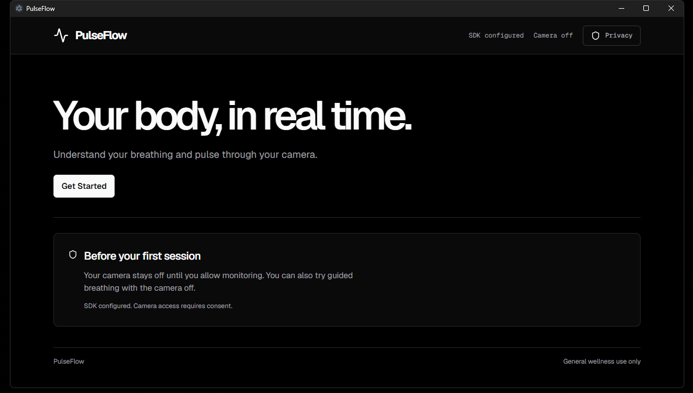
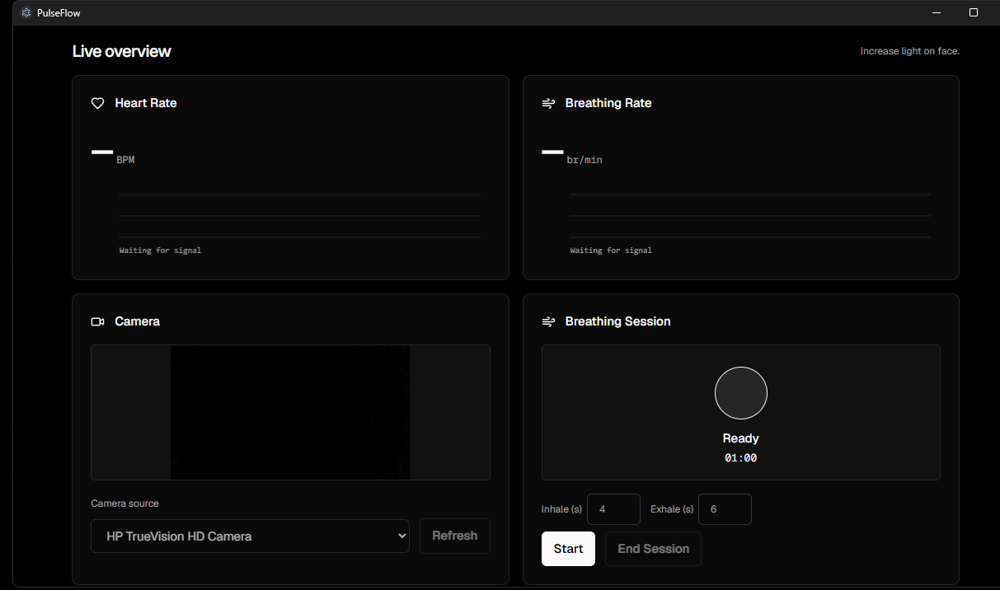
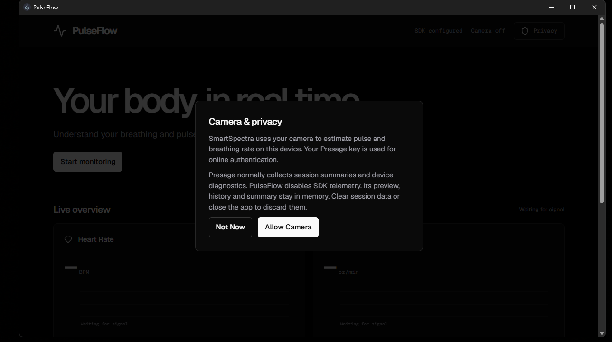

# PulseFlow

**Contactless physiological sensing. Thoughtfully designed.**

A privacy-conscious desktop application that transforms an ordinary webcam into a real-time human-sensing experience, powered by the **Presage SmartSpectra SDK**.

Built for the **Presage SmartSpectra SDK Challenge 2026**.

[](https://www.electronjs.org/)
[](https://www.typescriptlang.org/)
[](https://presagetech.com/)
[](#getting-started)
[](https://dev.to/challenges)

---



## Overview

**Your body, in real time.**

PulseFlow is an experimental human-sensing desktop application that combines contactless physiological monitoring with a guided breathing experience.

Using a standard webcam and Presage SmartSpectra, PulseFlow estimates physiological signals such as heart rate and breathing rate without requiring wearable devices.

The application presents these measurements through a clean, interactive dashboard and allows users to follow guided breathing sessions while observing their physiological signals.

The experience is built around three principles:

- **Real signals:** Physiological values originate from the SmartSpectra SDK, not simulated datasets.
- **Thoughtful interaction:** An approachable interface combines live measurements, guided exercises, and session summaries.
- **Privacy and control:** Explicit consent, user-controlled capture, clear measurement states, and responsible data handling are central to the experience.

PulseFlow is intended for general wellness exploration and technical demonstration. It is not a medical device.

---

## The Experience

### 01. A simpler way to explore physiological signals

PulseFlow introduces contactless sensing through a minimal desktop experience.

Rather than overwhelming users with technical information, the interface focuses on clarity, readability, and direct interaction.

The visual direction is inspired by the minimalism of contemporary developer tools, with monochromatic surfaces, restrained motion, subtle borders, and precise typography.


### 02. Real-time monitoring

Heart rate and breathing rate are presented through clear numerical indicators and time-based charts.

The dashboard displays new measurements only when valid signals are available from SmartSpectra.



**Monitoring capabilities**

- Contactless heart rate estimation in BPM.
- Contactless breathing rate estimation in breaths per minute.
- Time-series visualization of accepted samples.
- Camera and processing status feedback.
- Signal-quality guidance.
- Explicit empty states when measurements are unavailable.

PulseFlow never fabricates physiological readings to populate its dashboard.

### 03. Explicit camera consent

Physiological sensing begins only after the user grants consent.

The application provides information about camera access and allows users to control monitoring.



### 04. Privacy by design

The application is designed to avoid unnecessary persistence of sensitive session data.

Camera-based sensing should always be transparent, intentional, and controlled by the person being monitored.


### 05. Meaningful session summaries

At the end of a guided breathing session, PulseFlow displays a concise summary of the activity.


The summary includes:

- Session duration.
- Average observed heart rate.
- Average observed breathing rate.
- Number of valid pulse samples.
- Number of valid breathing samples.
- Session completion status.

Averages are calculated from accepted measurements collected during the session. Missing data is not replaced with fabricated values.

---

## Key Features

| Feature | Description |
|---|---|
| Contactless monitoring | Estimate physiological signals through a supported webcam |
| SmartSpectra integration | Receive live SDK events and structured measurements |
| Heart rate | Display valid pulse estimates in BPM |
| Breathing rate | Display valid respiration estimates in breaths per minute |
| Live charts | Visualize accepted physiological readings over time |
| Guided breathing | Follow configurable inhale and exhale phases |
| Session controls | Start, pause, resume, and end an exercise |
| Session summaries | Review duration, averages, and valid sample counts |
| Camera selection | Select an available camera device |
| Consent workflow | Require explicit consent before monitoring |
| Notifications | Display contextual feedback without interrupting the experience |
| Signal validation | Reject unavailable or invalid readings rather than simulating results |

---

## How It Works

PulseFlow connects to a supported webcam through the official Presage SmartSpectra Node.js SDK.

The SDK processes camera input and emits physiological measurement and validation events.

PulseFlow decodes the SDK measurements, applies validity checks, and updates the desktop interface with accepted values.

```text
              STANDARD WEBCAM
                     |
                     v
          PRESAGE SMARTSPECTRA
                     |
          +----------+----------+
          |                     |
          v                     v
    Signal Validation      SDK Measurements
          |                     |
          +----------+----------+
                     |
                     v
             Measurement Layer
                     |
              Valid Samples
                     |
                     v
              Electron IPC
                     |
                     v
               PulseFlow UI
                     |
          +----------+----------+
          |                     |
          v                     v
      Live Charts         Session Summary
```

### SmartSpectra Integration

The application requests these metrics:

```typescript
requestedMetrics: [
  MetricType.PULSE_RATE,
  MetricType.BREATHING_RATE,
]
```

The integration handles SDK events associated with:

- Processing status.
- Signal validation.
- Physiological metrics.
- Camera video output.
- SDK errors and interruptions.

Measurement messages are decoded through the SDK's Protocol Buffers support.

### Actual measurements only

PulseFlow intentionally distinguishes between a working camera and valid physiological data.

When a camera is active but no acceptable measurement is available, the interface displays:

```text
Heart Rate:     —
Breathing Rate: —
Status: Waiting for signal
```

The application does not generate synthetic BPM values, artificial respiration rates, or fabricated session averages.

### Signal quality requirements

Reliable measurements depend on factors including:

- Adequate lighting.
- Visible face and upper-body framing.
- Minimal movement.
- Supported camera capture formats.
- Sufficient effective frame rate.
- Stable physiological signals.

SmartSpectra may request adjustments when capture conditions are insufficient.

---

## Guided Breathing

PulseFlow includes a guided breathing exercise designed to complement real-time monitoring.

Users can configure the duration of inhalation and exhalation phases and follow a minimal animated indicator.

The experience supports:

- Starting a session.
- Pausing and resuming.
- Ending a session.
- Configuring breathing phases.
- Reviewing the completed session.

The animation follows the exercise timer, not fabricated physiological measurements.

Breathing guidance is independent of the measured respiration signal.

The exercise is a general wellness interaction, not a treatment or medical intervention.

---

## Design & User Experience

PulseFlow uses an original monochromatic design inspired by the clarity of Vercel's interface language and Geist typography.

### Visual principles

- Minimal, dark desktop interface.
- Neutral black, white, and gray palette.
- Clear visual hierarchy.
- Large, legible physiological metrics.
- Fine borders and restrained surfaces.
- Subtle animations and transitions.
- Purposeful notification feedback.
- Reusable UI components.
- Accessible interaction patterns.

The objective is to make contactless human sensing feel understandable and approachable rather than overly clinical or technical.

---

## Technology Stack

| Technology | Role |
|---|---|
| Electron | Desktop runtime and native application shell |
| Node.js | Application services and SDK integration |
| TypeScript | Typed application logic |
| Presage SmartSpectra SDK | Contactless physiological sensing |
| Protocol Buffers | SDK measurement decoding |
| HTML5 | User interface |
| CSS | Layout, styling, and animations |
| Canvas API | Camera preview and chart rendering |
| Node.js Test Runner | Automated testing |

No dedicated backend or database is required for the desktop application.

---

## Project Structure

```text
PulseFlow/
├── assets/                 # Screenshots and documentation assets
├── src/                    # Electron and SmartSpectra integration
│   ├── main.ts             # Main process
│   ├── capture.ts          # Native SDK capture lifecycle
│   ├── camera.ts           # Camera discovery and preview
│   ├── measurements.ts     # Measurement processing
│   ├── errors.ts           # SDK error handling
│   └── model.ts            # Shared application types
├── ui/                     # Desktop interface
│   ├── index.html
│   ├── app.ts
│   └── style.css
├── tests/                  # Automated tests
├── build.mjs               # Application build
├── package.json
├── package-lock.json
├── .env.example
├── .gitignore
└── README.md
```

The architecture separates native sensing from presentation logic and session management.

---

## Getting Started

### Requirements

- Windows 11 x64.
- Node.js compatible with the installed SmartSpectra SDK.
- npm.
- A supported webcam.
- A Presage SmartSpectra API key.
- Internet access for SDK services when required.

### 1. Clone the repository

```bash
git clone https://github.com/Ezequie1Sc/PulseFlow.git
cd PulseFlow
```

### 2. Install dependencies

```bash
npm ci
```

### 3. Configure SmartSpectra

Create a local environment file.

**PowerShell:**

```powershell
Copy-Item .env.example .env
```

Open `.env` and provide your Presage API key using the configured variable:

```dotenv
SMARTSPECTRA_API_KEY=your_presage_api_key
```

Never commit the real API key.

### 4. Launch PulseFlow

```bash
npm run dev
```

This command builds the application and launches Electron.

### 5. Start monitoring

1. Review the consent information.
2. Allow camera-based monitoring.
3. Select the webcam.
4. Start monitoring.
5. Position your face and upper chest within the frame.
6. Remain still while the SDK acquires valid signals.
7. Observe live measurements.
8. Start a guided breathing exercise.
9. Review the resulting session summary.

---

## Development Commands

| Command | Purpose |
|---|---|
| `npm ci` | Install dependencies from the lockfile |
| `npm run build` | Run TypeScript validation and build the application |
| `npm run dev` | Build and launch Electron |
| `npm start` | Launch Electron |
| `npm test` | Run automated tests |

### Build

```bash
npm run build
```

### Test

```bash
npm test
```

The test suite covers core functionality such as:

- Session phase timing.
- Pause and resume behavior.
- Session summary calculations.
- Measurement decoding and filtering.
- Toast deduplication.
- Error handling.
- Consent and session controls.
- Electron security behavior.

Automated tests and successful builds do not independently establish successful physiological sensing. Real-camera testing is required to verify the complete integration.

---

## Privacy, Consent & Responsible Data Handling

Privacy is a central requirement of the PulseFlow experience.

### Consent

Camera monitoring is initiated only after explicit user consent.

Users can stop monitoring and end the current session.

### Camera data

The application uses a webcam and Presage SmartSpectra to obtain physiological estimates.

A local camera preview is available in the desktop interface. Demo screenshots and recordings should obscure identifying imagery when necessary.

### Session information

The application uses measurement data to display live values, charts, and session summaries.

The architecture does not depend on a dedicated user database or cloud account system.

Session data is intended to remain temporary and under the user's control.

### Storage and retention

PulseFlow does not implement a dedicated persistent physiological-history database.

Any claim about local files, logs, caches, or native SDK retention must be verified against the specific application build and Presage SDK behavior.

### SDK telemetry and network activity

The SmartSpectra initialization includes:

```typescript
enableTelemetry: false
```

This disables the configurable telemetry option in the application.

It does not necessarily disable every SDK network interaction, authentication request, or other provider-side data processing.

For authoritative information about SDK behavior and provider data practices, consult the official Presage documentation.

### Optional AI services

PulseFlow does not require a separate generative AI service for physiological monitoring or guided breathing.

### Responsible use

PulseFlow is not intended for:

- Medical diagnosis.
- Medical treatment.
- Clinical decision-making.
- Emergency response.
- Covert monitoring.
- Non-consensual surveillance.

All physiological values are estimates and should not be interpreted as medical findings.

---

## Troubleshooting

### Camera unavailable

Check Windows camera permissions, close competing camera applications, and confirm the camera is connected.

### Waiting for signal

Improve lighting, reduce motion, ensure your face and upper chest are visible, and allow time for valid measurements.

### Frame rate too low

Use a camera mode capable of maintaining at least 25 FPS. A lower resolution at 30 FPS may work better on some hardware.

### SDK connectivity error

Verify internet access, API key configuration, and connectivity to the required Presage services.

### Missing measurements

PulseFlow only displays accepted SDK measurements. Invalid or unstable values are intentionally excluded.

---

## Demo & Challenge Submission

PulseFlow was developed for the **Presage SmartSpectra SDK Challenge 2026** on DEV Community.

The demonstration highlights:

1. Desktop application startup.
2. Camera consent.
3. Native SmartSpectra integration.
4. Real-time physiological measurements.
5. Guided breathing.
6. Session completion.
7. Measurement-based summary results.

**Demo video:** To be added before final submission.

**DEV submission:** To be added after publication.

### Challenge Categories

- Best Overall Human-Sensing Experience
- Best Thoughtful Real-World Use

The application combines the use of live camera-based physiological signals with user-controlled monitoring, a minimal interaction model, and an approachable guided experience.

---

## Future Improvements

Potential future development includes:

- A camera-preview privacy toggle.
- Additional breathing patterns.
- More detailed capture-quality guidance.
- Camera compatibility diagnostics.
- Additional accessibility controls.
- Broader platform support where supported by SmartSpectra.

These are planned possibilities rather than existing features.

---

## Disclaimer

PulseFlow is an experimental application created for educational, demonstration, and general wellness purposes.

Camera-based physiological estimates may be affected by lighting, movement, camera quality, capture conditions, and algorithmic limitations.

**PulseFlow is not a medical device and must not be used for diagnosis, treatment, or clinical monitoring.**

---

## Author

**Ezequiel Salazar**

Computer Systems Engineering Student | Software Developer

[GitHub](https://github.com/Ezequie1Sc)

---

## Acknowledgments

Built with the [Presage SmartSpectra SDK](https://smartspectra.presagetech.com/docs/nodejs/) for the Presage SmartSpectra SDK Challenge 2026.

Thanks to Presage and DEV Community for supporting experimentation with contactless human sensing.

---

**PulseFlow — Your body, in real time.**